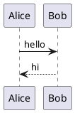

# dsh-sidebar-plantuml

在 **DSH 右侧边栏的 Markdown 文件预览**里直接渲染 PlantUML 图表。每个
` ```plantuml ` 代码块都会变成可交互的 SVG；不需要 Java、PlantUML 服务或网络请求，
渲染完全在浏览器本地完成。

这是一个独立的 DSH 插件（npm 包 + host/browser 两端），安装后会自动挂载到
profile 的 loader，不依赖 `dsh-better-sidebar` 或其他第三方侧边栏插件。

## 支持的能力

- 支持 `plantuml`、`puml`、`uml`、`iuml`、`pu`、`wsd` 代码块；也识别包含完整
  `@start…` / `@end…` 对的无语言代码块。
- 侧边栏内置 Markdown 预览、`dsh-better-sidebar` 的预览、聊天区域和工具结果中的
  Markdown 代码块都能渲染。
- 每个代码块有“图片 / 代码”切换、复制源码、全屏查看（缩放、拖动）、下载 SVG/PNG。
- 跟随浅色/深色主题重新渲染。
- 纯浏览器 TeaVM 引擎，包含 PlantUML 标准库；不访问网络。

## 安装

### 从 GitHub 安装（推荐，当前尚未发布 npm 包）

```sh
dsh plugin --profile web add github:j20cc/dsh-sidebar-plantuml
```

或者直接使用 Git URL：

```sh
dsh plugin --profile web add https://github.com/j20cc/dsh-sidebar-plantuml.git
```

安装后重启 `dsh web`（或让当前 profile 的 HMR 重新加载），刷新页面即可。

### 从本地目录安装

```sh
dsh plugin --profile web add file:/absolute/path/to/dsh-sidebar-plantuml
```

如果 profile 还没有自动加载插件，可在 `~/.dsh/profiles/<profile>/cordis.patch.yml`
添加：

```yaml
- insert:
    - id: dsh-sidebar-plantuml
      name: 'dsh-sidebar-plantuml'
```

（包内已经带有 `cordis.patch.yml` 和 `dsh.bundle.patch`，正常情况下
`dsh plugin add` 会自动处理，不需要手工编辑。）

## 使用

在侧边栏打开一个 Markdown 文件，写入：

````md

````

保存后即可看到图表。代码块上方的“图片 / 代码”按钮可以随时切回源码。

## 注意

- 如果同时安装了 `dsh-plantuml`（同一个上游插件的旧名字），两个插件会同时接管
  相同的代码块，造成重复渲染；请先移除旧插件再安装本插件。
- 代码块识别是启发式的：普通代码块如果同时包含匹配的 `@start…` / `@end…` 对，
  也会被当作 PlantUML 处理，此时点“代码”即可查看原文。
- 单张图渲染最长 20 秒；超时会显示错误而不是卡住整个预览。
- 本插件基于 [dlutcat/dsh-plantuml](https://github.com/dlutcat/dsh-plantuml)
  的 MIT 代码 fork 并针对侧边栏场景重新打包，保留原作者的 LICENSE 与 NOTICE。

## License

[MIT](LICENSE) © dlutcat；本 fork 的修改与打包 © 2026 j20cc.

## Third-party software

`vendor/plantuml.js` 和 `vendor/stdlib/*` 来自 PlantUML 官方
[plantuml/plantuml-for-github](https://github.com/plantuml/plantuml-for-github)
的 MIT 构建；详见 [NOTICE.md](NOTICE.md)。
